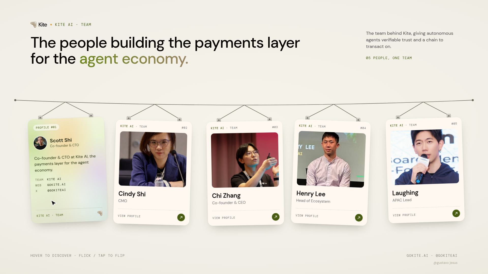

# Kite Team Cards

Hanging team ID cards for the Kite AI team. Each card hangs from a wire on two tethers. Hover a card to flip it and see the back, drag it to swing it on its tethers, or flick it sideways to spin it.

**Live demo:** https://gustavojesuss69.github.io/kite-team-cards/



## Interactions

| Action | Result |
| --- | --- |
| Hover | The card flips in 3D to its back, which has a moving gradient and a glare that follows the cursor |
| Drag | The card swings on its tethers and springs back like a pendulum |
| Flick | The card spins a few turns, slows down, and settles on its front or back |
| Tap (touch) | Flips the card |

## Run locally

```bash
npm install
npx vite          # dev server
npx vite build    # static build in dist/
```

No framework is used, only plain JavaScript and CSS 3D transforms. The physics runs on a fixed 240 Hz step, so the same input always gives the same motion.

## Make it your own

- People are listed in `src/team.js` (name, role, photo).
- Photos are in `public/team/1.jpg` to `5.jpg`. Replace a file to change a portrait. Square images work best.
- Colors are CSS variables at the top of `src/style.css`.

## Render a video

`render.mjs` drives the page in headless Chrome frame by frame using the scripted cursor path in `src/script.js`.

```bash
npx vite --port 5311 &
node render.mjs dir=frames
ffmpeg -framerate 30 -i frames/f%05d.jpg -pix_fmt yuv420p demo.mp4
```

## Credits and license

The code is MIT licensed (see `LICENSE`). Team photos and the Kite logo belong to [Kite AI](https://gokite.ai) ([@GoKiteAI](https://x.com/GoKiteAI)) and are not covered by the MIT license.

Made by Gustavo Jesus.
